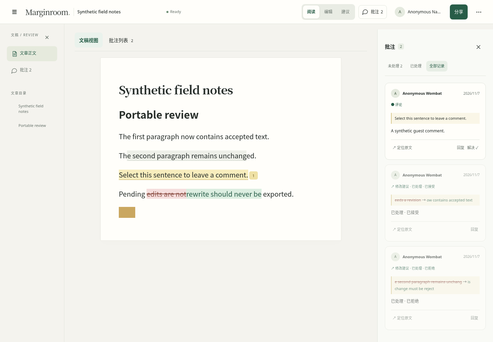

# Marginroom

Review HTML pages without moving them into a document editor. Import a page, comment on its elements, suggest bounded text changes, and export the accepted result.



## Run locally

You need Docker with Compose v2:

```sh
cp .env.example .env
docker compose up --build -d
```

Open **http://localhost:3939**. The default setup listens only on your machine. Documents, review history and identity keys live in a persistent Docker volume. `docker compose down -v` deletes that data.

For configuration, administrator recovery, native Node setup and backups, see [Running Marginroom](docs/operations.md).

## Import, resume and review

1. From the homepage, choose **导入 HTML**, select an HTML file and its local images (or paste source), then explicitly import and open. Duplicate names offer keep-both, replace or cancel. Replacement changes the source while retaining existing review history, which may no longer match; keep both to preserve the original independently.
2. **最近打开** resumes links successfully opened in this browser. Search by title; remove or clear these local records without deleting server documents. **我的文稿** lists documents created by the current signed browser identity, not public examples or every document an administrator can manage. Deletion is a separate, permission-checked destructive action.
3. Documents start in **浏览 (Browse)**. Original page controls remain usable. **批注 (Annotate)** selects rendered elements; use the element context to comment, move to a parent/child, or suggest text changes where supported. Drag-selected text supports comments, not arbitrary direct editing.
4. Click a supported single text block to edit a local inline suggestion. Submit it for review; the original stays unchanged until its owner accepts it. Reply, resolve/reopen comments, or accept/reject revisions through **批注栏** and its filtered list. A pending revision still blocks another revision of the affected block; this is not continuous multi-hunk editing.
5. The viewer's **Marginroom** link returns home. Reading coordinates and viewport preferences are browser-local; returning to a static preview restores its reading position without reloading its frame. Unsaved review drafts require explicit handling before leaving. Interactive application state is not saved or replayed.
6. Set link access, copy the direct viewer URL, and export accepted HTML when ready. Authorized direct original editing and version history are available in the overflow menu.

Device previews use real isolated iframe viewports, with Desktop/Laptop/Tablet/Phone/custom dimensions, rotation and Fit/100% stage pan. Preferences are per document. This is viewport sizing, not full device or Safari emulation.

## Identity and access

**Anyone who can reach the instance and knows a document URL can read it.** No public document index does not mean a private document. Sharing does not create individual invitations or accounts.

- **Read:** page only; visitors cannot see discussion records or counts.
- **Suggest:** page, comments and proposed changes.
- **Edit:** also permits direct text editing.

Only the document owner or instance administrator can manage sharing, accept/reject suggestions, restore history or delete documents. The administrator's recovery cookie/key is separate from the uploader's browser identity. Display names do not prove ownership. Changing browsers/devices does not sync ownership, recent history or reading coordinates. See [ownership recovery](docs/operations.md#identity-ownership-and-cookie-recovery).

For confidential material, use an external login gate or private network. A private source repository does not protect a running instance.

## Current limits

- Inline rewriting is bounded to supported single-block source text. Safe inline formatting is preserved where the source mapping supports it; arbitrary rich/grouped, cross-block and runtime-generated content remains comment-only. Resolve an existing pending revision before revising its block again.
- Static exports include uploaded `` images, including original animated GIF bytes. Remote images, CSS backgrounds, `<picture>` sources and interactive dependencies are not bundled. Image filenames share an instance-wide namespace; a selected conflicting image must be renamed together with its HTML reference.
- Interactive scripts run inside an opaque-origin sandbox, not the review application's origin. Only numeric inner-scroll and shell/stage coordinates are retained for interactive documents, never their internal forms or application state.
- Exported HTML does not inherit the viewer sandbox. Coarse cleanup is not a complete HTML sanitizer; only open downloads from authors you trust.
- The tool UI is Chinese. Chromium is tested; physical iPhone/Safari behavior remains a device check.

## Development

Tested with Node **22.23.4**:

```sh
npm ci
npm test
node test/home-entry-api.test.mjs
node test/home-entry.browser.mjs
```

For additional suites, install Chromium with `npm run browser:install` and see the [test guide](test/README.md). [Operations evidence](release/operations-evidence.md) documents alpha Docker/recovery checks.

## Credits and license

Based on [markmyword](https://github.com/alexagriffith/markmyword) by Alexa Griffith, with a revised review interface, inline suggestions and self-hosting tools. [MIT license](LICENSE); original copyright and license notices are preserved.
