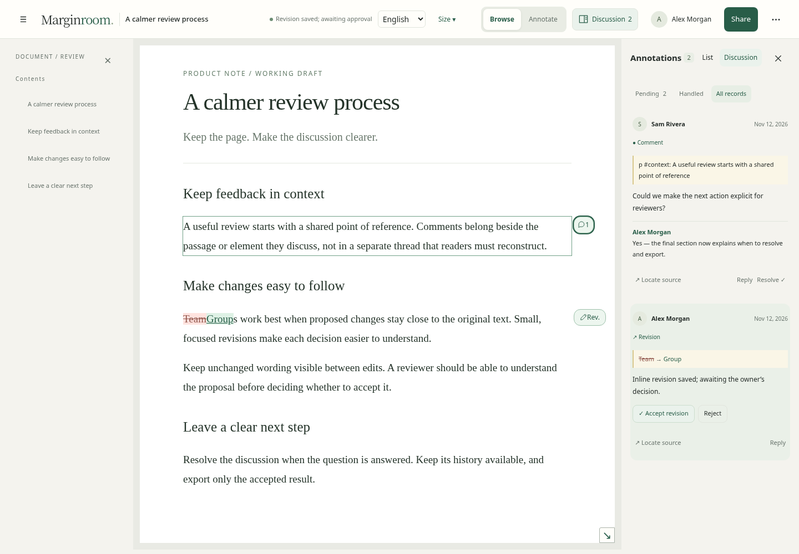

# Marginroom

[English](README.md) · 简体中文

在浏览器里审阅 HTML，把反馈交给你的 agent。

打开生成好的页面，在原文旁添加批注或提出修订，再从终端读取讨论或输出 JSON。原始 HTML 文件不会被改写。



## 安装

支持 macOS Apple Silicon、Intel，以及使用 glibc 的 Linux x64。无需另装 Node、Bun，也不需要 sudo。

```sh
curl -fsSL https://github.com/TomCC7/marginroom/releases/latest/download/install.sh | sh
```

命令将最新发布版安装到 `~/.local/bin`。如果提示该目录不在 PATH 中，按提示配置。平台限制与 macOS 安全提示见[安装说明](docs/installation.md)。

## 审阅页面

```sh
marginroom open ./article.html --browser
```

Marginroom 会启动本地服务并打开页面。切换到 **Annotate（批注）**，选择文字或元素，即可添加批注、提出修订建议并在线程中回复。界面支持中英文切换。

## 读取反馈

复制浏览器中的审稿页面 URL，在终端查看讨论：

```sh
marginroom comments '审稿页面URL'
```

也可以输出包含记录 ID、引用原文和回复的 JSON，供 agent 处理：

```sh
marginroom comments '审稿页面URL' --json
```

URL 请保留引号。加上 `--status all` 可查看所有状态的反馈，更多选项见 `marginroom comments --help`。

## 继续改稿

再次打开未改动的文件，会回到原有审稿。修改 HTML 后，显式创建新版本：

```sh
marginroom open ./article.html --new-version-of '原审稿页面URL' --browser
```

新版本默认显示有权查看的祖先版本讨论，包含完整评论与回复。精确未变的目标附着当前正文；已变更或不唯一的目标保留为历史讨论，并提供原始版本链接。旧记录不改写。[详细规则](docs/version-feedback.md)。

本地审稿链接只能在运行服务的电脑上访问。需要跨设备审稿时，请[连接可访问的实例](docs/agent-workflow.md)。任何能访问文稿 URL 的人都能阅读文稿。

## 文档

[使用指南](docs/user-guide.md) · [Agent 工作流](skills/marginroom/SKILL.md) · [从源码构建](docs/installation.md#source-builds) · [托管与备份](docs/operations.md)

### 维护与部署

从 v0.1.4 起，服务账号可用 `touch` 创建 `MMW_MAINTENANCE_FILE` 指定的标志文件，无需 root 或重启。读取照常；新写请求返回 `503` 和 `Retry-After`，浏览器会保留未提交的输入。部署脚本应轮询运行中实例的 `/api/maintenance/status`，确认 `maintenance: true` 且 `inflight: 0` 后发送 `SIGTERM`。等旧进程退出再替换服务，验证新实例正常后移除标志文件以恢复写入。`SIGTERM` / `SIGINT` 停止接收新连接，默认最多等待 30 秒排空已接收请求，可通过 `MMW_SHUTDOWN_TIMEOUT_MS` 调整。

默认路径、Compose 命令以及从低于 v0.1.4 的版本首次升级的注意事项，见[部署手册](docs/operations.md#maintenance-and-graceful-deploys)。

采用 [MIT 许可证](LICENSE)。基于 Alexa Griffith 的 [markmyword](https://github.com/alexagriffith/markmyword) 开发。
